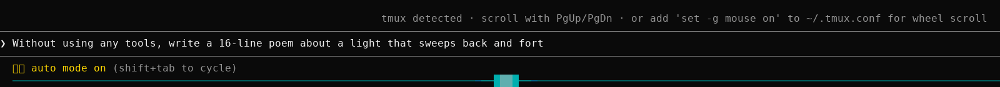

# claude-cli-status-orb-mod

A Cylon-style status orb for the Claude Code CLI. While Claude works, a red orb sweeps edge to
edge along the bottom of the terminal, under the prompt. When Claude finishes, the orb's swings
shrink and slow into the center, it cools to cyan, and it breathes until there's more to do.



<sub>Recorded in Claude Code 2.1.317.</sub>

## Install

At the prompt of a Claude Code terminal session:

```
/plugin install larson-scanner --marketplace michaelgtodd/claude-cli-status-orb-mod
```

Answer `y` to add the marketplace, then press Enter to install it for your user (every session
you start from then on).

Or from a shell:

```sh
claude plugin install larson-scanner --marketplace michaelgtodd/claude-cli-status-orb-mod
```

## What it does

- **Working:** a red orb with a white-hot center sweeps the full width, flared ahead of it and
  tapering into a long trail that steps thinner as it cools. Each time it reaches an edge its speed
  shifts by up to 5% either way, staying within 30% of the default. When work starts it launches
  straight into a full sweep, so its first pass reaches the edge.
  Background shells, subagents and workflows count as work: the orb keeps sweeping until they
  finish, even after Claude has handed the prompt back.
- **Finishing:** each swing falls shorter than the last as it slows into the center, cooling
  through magenta, violet and blue to cyan.
- **Idle:** the cyan orb rests in the center and breathes, brighter and wider, then dimmer and
  tighter.

Claude Code's own hint line (`esc to interrupt` and the rest) stays where it is, just above the
orb, and the orb runs the full width of the terminal, beneath any docked pane. The list of running
subagents stays below the orb: Claude Code draws it last, on the screen's bottom row.

## Requirements

- Claude Code with mods (function hooks). Built and tested on 2.1.317; the mod API is early
  access and may change between releases.
- A terminal with truecolor. The orb draws in the terminal only; in the desktop app and VS Code
  it stays out of the way.

## How it works

- `hooks/scanner.ts` is the animation: where the orb is, how the trail fades, the colors. It has
  no Claude Code imports, so it can be previewed and tested on its own.
- `hooks/ruler.ts` measures the row, since a mod's viewport shrinks to the transcript beside a
  docked pane.
- `hooks/register.tsx` draws it as one row of colored cells (a `Raster`) in the hint line under
  the prompt, and repaints that row 30 times a second with `$.ui.blit`. It knows Claude is
  working from the hint line's `isWorking` and the turn events, sees background shells in the
  hint line's text, polls `$.agent.list()` for subagents, and reads a turn's end for workflows.

## Develop

```sh
claude --plugin-dir /path/to/claude-cli-status-orb-mod   # reloads as you edit
claude plugin validate /path/to/claude-cli-status-orb-mod
```

## License

[MIT](LICENSE)
